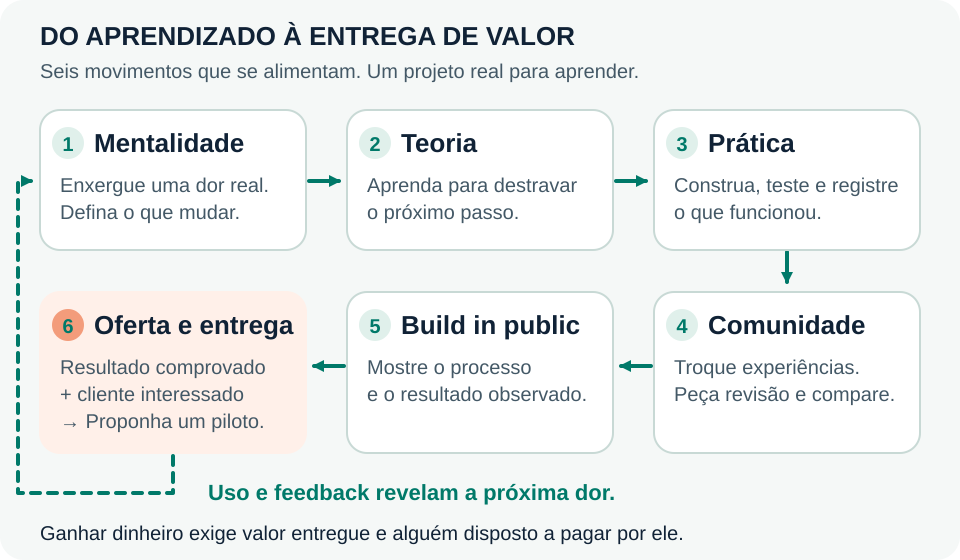

# Jornada do Engenheiro de IA

**Um guia de direção, não um curso.** Nesta página está o que você precisa saber, o que construir, onde aprender e com quem conversar. O aprendizado acontece fora daqui: nas fontes certas, na comunidade e no seu projeto.

<p class="compact-visual"><a href="mapas-e-desenhos/ciclo-de-valor.svg"></a></p>

## O que faz um Engenheiro de IA

**Liga um problema de negócio a uma solução técnica que funciona e prova que funcionou.** Escolhe onde a IA entra, constrói com modelo, dados e ferramentas, testa com casos reais e explica o resultado para quem vai usar.

A maior parte do trabalho é **processo, dado, integração e avaliação**. O modelo é a última peça a escolher, não a primeira.

## Comece por aqui

| Seu momento | Por onde ir |
| --- | --- |
| **Quer um caminho guiado, com suporte e comunidade** | **[Comunidade e curso da Dizevolv](https://comunidade.dizevolv.com/)**: curso *Construa seu próprio agente de IA*, comunidade fechada com quem está implementando IA em empresas e suporte do nosso time. É a minha comunidade, onde acompanho de perto quem segue esta jornada. |
| **Quer começar sem investir** | [Meu vídeo: crie um agente Hermes em menos de 20 minutos](https://youtu.be/VHh2D9agRps). O vídeo é aberto; o consumo de modelos e hospedagem depende da configuração. |
| **Já tem um agente funcionando** | Vá direto para a [prática](#pratica) com um problema real. |

## O mapa: sete focos

| Foco | O que você precisa conseguir fazer |
| --- | --- |
| [**1 · História**](#historia) | Contar como a IA chegou até aqui e as cinco lições que se repetem. Cai em entrevista. |
| [**2 · Fundamentos**](#fundamentos) | Explicar em uma frase cada um dos 27 conceitos básicos. |
| [**3 · Prática**](#pratica) | Ter um agente resolvendo um problema real, testado e demonstrado. |
| [**4 · Comunidade**](#comunidade) | Participar de uma comunidade e construir em público. |
| [**5 · Ecossistema**](#ecossistema) | Saber quem seguir no X e onde conversar no Discord. |
| [**6 · Onde buscar**](#onde-buscar) | Ir direto à fonte certa. |
| [**7 · Entrevista e mercado**](#entrevista) | Dominar os pontos mais cobrados e o que vai importar daqui pra frente. |

[](https://ailucasdz.github.io/jornada-engenheiro-de-ia/mapa.html)

## Como usar este guia

- **80% construindo, 20% estudando.** Estude o que o projeto pediu agora, não tudo de uma vez.
- **Ordem:** leia História e Fundamentos uma vez para ter o mapa na cabeça. A Prática é contínua, com Comunidade, Ecossistema e Onde buscar em paralelo. Passe para Entrevista e mercado quando tiver algo para mostrar.
- **Os blocos recolhidos (▸)** trazem o detalhe. Abra quando precisar.

## O que ter sempre em mente

1. **O modelo é commodity em queda de preço.** O valor está no entendimento do processo, no dado e na integração.
2. **Escopo estreito vence ambição larga.** Ataque um processo específico e caro, não "melhorar o atendimento".
3. **Prometa um número, não uma transformação.** Os invernos da IA foram causados por promessa, não por falha técnica.
4. **Prompt → RAG → fine-tuning, nessa ordem.** Cada degrau adiciona custo e manutenção.
5. **Fluxo antes de agente.** Dê autonomia só onde a variabilidade do problema justifica.
6. **O modelo pede; o seu código executa.** Permissão e segurança ficam fora do prompt.
7. **Sem eval, "melhorou" é opinião.** Casos reais, resultado binário, rodados a cada mudança.

---

<a id="historia"></a>

## 1 · História da IA

**Não é para decorar datas.** É para entender por que as coisas aconteceram nessa ordem, porque os mesmos padrões decidem quais projetos de IA dão certo numa empresa hoje.

**Pronto quando:** você conta a linha do tempo em dois minutos, explica backpropagation, escala e Transformer sem matemática e cita as cinco lições.

| Período | Marcos que você precisa citar | A lição |
| --- | --- | --- |
| **1943–1955 · Fundações** | Neurônio de McCulloch e Pitts (1943). Turing propõe o teste (1950). Samuel e o programa de damas que aprende; cunha *machine learning* (1959). | A pergunta filosófica virou teste operacional. Defina a métrica antes de aprovar o projeto. |
| **1956–1973 · Euforia** | Dartmouth dá nome à IA (1956). Perceptron de Rosenblatt (1958). ELIZA (1966). Minsky e Papert: o Perceptron não resolve o XOR (1969). Relatório Lighthill (1973). | As pessoas atribuem inteligência a quem só combina padrões. Impressiona na demonstração, quebra em produção. |
| **1974–1980 · 1º inverno** | Verba cortada nos EUA e no Reino Unido. | O inverno veio da distância entre o prometido e o entregue. |
| **1980–1987 · Sistemas especialistas** | MYCIN. XCON economizava cerca de US$ 40 milhões por ano na DEC: o primeiro ROI de IA numa empresa. Quinta Geração no Japão (1982). | Escopo estreito, regra clara e processo caro. A fórmula continua valendo. |
| **1987–1995 · 2º inverno** | Sistemas especialistas quebram pelo custo de manutenção. Rumelhart, Hinton e Williams popularizam a backpropagation (1986). | O que mata uma automação é o custo de manter. |
| **1995–2011 · Trabalho silencioso** | Deep Blue vence Kasparov (1997). Redes profundas treináveis (2006). ImageNet, de Fei-Fei Li (2009). Watson no *Jeopardy!* (2011). | O marco de 2009 é um conjunto de dados. O gargalo costuma ser dado organizado com resposta certa. |
| **2012–2022 · A virada** | AlexNet (2012). AlphaGo (2016). Transformer em *Attention Is All You Need* (2017). GPT-3 e *scaling laws* (2020). RLHF (2022). ChatGPT em 30/11/2022: 100 milhões de usuários em dois meses. | O maior evento comercial da IA foi de **interface**, não de modelo. |
| **2023–hoje · Agentes** | GPT-4, Claude, Gemini. Pesos abertos: Llama, Mistral, DeepSeek. Modelos de raciocínio e Nobel para Hinton, Hopfield, Hassabis, Jumper e Baker (2024). Era dos agentes (2025–2026). | O gargalo agora é "o processo está organizado para o modelo operar nele?". |

**Três conceitos para explicar sem matemática:**

- **Backpropagation (1986):** percorre a rede de trás para frente e ajusta cada parâmetro na medida da sua culpa pelo erro. *Por isso* o modelo não aprende com a sua conversa, treinar é caro e usar é barato, e *fine-tuning* exige gabarito.
- **Escala (2012 e 2020):** algoritmo de 1986 + dados de 2009 + GPUs = AlexNet. As *scaling laws* mostraram que mais dados, parâmetros e computação melhoram o modelo de forma previsível. *Por isso* o seu diferencial nunca é "usamos o melhor modelo".
- **Transformer e atenção (2017):** o modelo olha a frase inteira e calcula o quanto cada palavra importa para cada outra. *Por isso* deu para treinar em milhares de GPUs e manter contexto longo. É o "T" do ChatGPT.

**As cinco lições que se repetem:**

1. **Invernos são causados por promessa, não por falha técnica.**
2. **A tecnologia chega antes do caso de uso viável.** Pergunte que peça falta: dado, processamento, algoritmo ou processo.
3. **O gargalo muda de lugar.** Hoje é processo e integração.
4. **Escopo estreito ganha de ambição larga.** O XCON gerou milhões; a Quinta Geração queimou centenas de milhões.
5. **A camada que captura valor sobe com o tempo:** hardware, modelo, aplicação e, agora, fluxo de trabalho.

<details>
<summary>O que não repetir numa conversa técnica</summary>

| Circula por aí | O correto |
| --- | --- |
| "A Microsoft investiu US$ 10 bi na OpenAI antes do ChatGPT." | Foi depois, em janeiro de 2023, como reação ao sucesso. |
| "Turing previu que 70% não saberiam se falam com máquina." | O interrogador teria no máximo 70% de chance de acertar após cinco minutos. |
| "Hinton criou a backpropagation." | Ele a popularizou em 1986, com Rumelhart e Williams. A técnica é dos anos 70. |
| "O Nobel de Química de 2024 foi para o Google." | Foi dividido entre Hassabis e Jumper (DeepMind) e Baker (Universidade de Washington). |
| "Modelos passam no teste de Turing regularmente." | Existe um estudo controlado relevante (2025), não um corpo consolidado de evidências. |
| "LLM é inversão de matrizes." | É multiplicação de matrizes e ajuste por gradiente. |
| "É só um papagaio estatístico." | É uma tese contestada, de 2021. Cite como posição no debate. |
| "Os algoritmos já existiam, só faltava máquina." | Também faltavam backprop (1986), Transformer (2017) e RLHF (2022). |

**Nomes que transcrições erram:** Frank Rosenblatt, David Rumelhart, Yann LeCun, Yoshua Bengio, Alex Krizhevsky, Ilya Sutskever, MYCIN, XCON, XOR, ImageNet, AlexNet.

</details>

<details>
<summary>O que ler, em ordem: um item por nível</summary>

| Nível | Comece por | Para quê |
| --- | --- | --- |
| **1 · Entender o campo** | [*Artificial Intelligence: A Guide for Thinking Humans*, de Melanie Mitchell](https://us.macmillan.com/books/9781250404855/artificialintelligence/), ou [*Genius Makers*, de Cade Metz](https://www.penguinrandomhouse.com/books/565698/genius-makers-by-cade-metz/) | Como funciona por dentro, sem equações, e a história contada pelas pessoas. |
| **2 · Lógica de negócio** | [*Máquinas Preditivas*](https://www.predictionmachines.ai/) ou [*Co-Intelligence*, de Ethan Mollick](https://www.penguinrandomhouse.com/books/741805/co-intelligence-by-ethan-mollick/) | Decidir onde aplicar IA e como trabalhar junto com ela. |
| **3 · Técnico e legível** | [*AI Engineering*, de Chip Huyen](https://huyenchip.com/books/) | O livro do cargo: RAG, avaliação, custo e quando fazer *fine-tuning*. |
| **4 · Textos originais** | [*The Bitter Lesson*, de Rich Sutton](http://www.incompleteideas.net/IncIdeas/BitterLesson.html) | Três páginas, o mais importante da lista. Depois: [Turing, 1950](https://turingarchive.kings.cam.ac.uk/publications-lectures-and-talks-amtb/amt-b-9), [Attention Is All You Need](https://arxiv.org/abs/1706.03762), [Scaling Laws](https://arxiv.org/abs/2001.08361) e [RLHF](https://arxiv.org/abs/2203.02155). Leia introdução e conclusões. |
| **Vídeo** | [3Blue1Brown: redes neurais](https://www.3blue1brown.com/topics/neural-networks) | A melhor explicação visual de backpropagation. Para abrir o capô: [Karpathy: Zero to Hero](https://karpathy.ai/zero-to-hero.html). |

**Não comece por** *Deep Learning* (Goodfellow) nem *Artificial Intelligence: A Modern Approach* (Russell e Norvig). São obras de referência, não leitura corrida.

</details>

**Material completo:** [Como a inteligência artificial chegou até aqui](materiais/historia-da-ia-material-de-formacao.html), cerca de 25 minutos.

<a id="fundamentos"></a>

## 2 · Fundamentos: os 27 conceitos

São 27 conceitos, divididos em cinco blocos, na ordem em que precisam ser aprendidos. Para cada um, você precisa saber **o que é** e **como falar dele** numa conversa técnica.

**Pronto quando:** você explica cada conceito em uma frase e sabe em qual parte do seu projeto ele aparece.

| Bloco | Conceitos | O que ter em mente |
| --- | --- | --- |
| **1 · O que o modelo faz** | LLM, token, janela de contexto, prompt e system prompt, treinamento × inferência, temperatura, alucinação | O modelo só prevê o próximo token. Ele não consulta nada e não lembra de nada entre chamadas. Tudo que ele usa precisa estar no que você enviou. |
| **2 · RAG e dados da empresa** | Embedding, banco vetorial, chunking, RAG, fine-tuning, três camadas de falha, três formas de dar conhecimento | RAG busca o trecho certo e o coloca no prompt; o modelo não aprende nada. Quando a qualidade cai, olhe primeiro a recuperação, não o modelo. |
| **3 · De chatbot a agente** | Tool use, agente, fluxo × agente, MCP, orquestração | O modelo pede a ação e o seu código executa. Agente precisa de critério de parada e limite. Comece com fluxo determinístico. |
| **4 · Infraestrutura** | API/REST, SQL e warehouse, ETL e pipeline, serverless, latência, custo e cache | Nada disso é IA, e aparece em toda vaga. A maior parte do trabalho é dado e integração. Se for aprender uma coisa de código, aprenda SQL. |
| **5 · Qualidade e risco** | Eval, observabilidade, guardrails e injeção de prompt | Eval com 20 a 50 casos reais, resultado binário, travando o deploy. Todo conteúdo externo é entrada não confiável. |

<details>
<summary>Os 27 conceitos, um a um: o que é e como falar</summary>

**Bloco 1 · O que o modelo faz**

| Conceito | O que é | Como falar |
| --- | --- | --- |
| **1 · LLM** | Prevê o próximo pedaço de texto, repetido milhares de vezes. | "Ele não consulta nada sozinho." |
| **2 · Token** | Pedaço de palavra; em português, cerca de 3–4 caracteres. | "Custo se calcula por token, entrada e saída separadas." |
| **3 · Janela de contexto** | Tudo que cabe numa chamada. É zerada a cada chamada. | "A aplicação remonta o contexto a cada vez." |
| **4 · Prompt e system prompt** | O prompt é tudo que vai na chamada; o system prompt é a parte fixa com regras. | "O system prompt é versionado como código." |
| **5 · Treinamento, inferência e corte** | Treinar constrói o modelo; inferência é usá-lo; o corte é até quando ele viu dados. | "A gente não treina com o dado do cliente; dá acesso na consulta." |
| **6 · Temperatura** | Quanto o modelo arrisca em vez de escolher o mais provável. | "Tarefa determinística, temperatura baixa." |
| **7 · Alucinação** | Resposta que soa correta e não é. É o mecanismo funcionando, sem verificação. | "Alucinação se reduz e se detecta, não se elimina." |

**Bloco 2 · RAG e dados da empresa**

| Conceito | O que é | Como falar |
| --- | --- | --- |
| **8 · Embedding** | Texto convertido em números que representam o significado. | "Acha o trecho mesmo com palavras diferentes." |
| **9 · Banco vetorial** | Guarda vetores e busca os trechos mais parecidos. | "pgvector no Postgres que já existe resolve a maioria." |
| **10 · Chunking** | Quebrar documentos em pedaços antes de indexar, respeitando a estrutura. | "Quando o RAG vai mal, olho primeiro o chunking." |
| **11 · RAG** | Buscar os trechos e colocá-los no prompt. Dois momentos: indexar e consultar. | "Mudou o documento, mudou a resposta." |
| **12 · Fine-tuning** | Continuar o treino com exemplos seus. Ensina formato e tom, não fatos. | "Resolve estilo, não conhecimento." |
| **13 · Três camadas de falha** | Recuperação, geração e resultado. | "Antes de trocar o modelo, isolo a camada." |
| **14 · Três formas de dar conhecimento** | Prompt para o pequeno e estável; RAG para o grande ou que muda; fine-tuning para formato. | "Prompt, depois RAG, fine-tuning por último." |

**Bloco 3 · De chatbot a agente**

| Conceito | O que é | Como falar |
| --- | --- | --- |
| **15 · Tool use** | O modelo pede a chamada de uma função; o seu código executa. | "Permissão fica no código, nunca no prompt." |
| **16 · Agente** | Ciclo de decisão: objetivo, passo, ferramenta, resultado, nova decisão. | "Precisa de critério de parada e ponto humano." |
| **17 · Fluxo × agente** | No fluxo você desenha os passos; no agente ele monta o caminho. | "Autonomia só onde a variabilidade justifica." |
| **18 · MCP** | Padrão aberto para conectar modelos a ferramentas e dados. | "Padroniza a conexão; não resolve permissão nem custo." |
| **19 · Orquestração** | LangChain, LangGraph, n8n, LiteLLM: organizam o trabalho em volta do modelo. | "Framework é o que mais muda. Escolho pelo que o time mantém." |

**Bloco 4 · Infraestrutura**

| Conceito | O que é | Como falar |
| --- | --- | --- |
| **20 · API e REST** | Sistemas conversando: endpoint, GET/POST, JSON, chave, webhook, rate limit. | "Atenção ao rate limit e ao erro do outro lado." |
| **21 · SQL e warehouse** | SQL consulta bancos; BigQuery e Snowflake servem para análise. | "O modelo é a última etapa; antes vem o dado." |
| **22 · ETL e pipeline** | Extrair, transformar e carregar de forma automática. | "Base de RAG sem pipeline morre em três meses." |
| **23 · Serverless** | Código sem servidor ligado, como AWS Lambda. Atenção ao cold start. | "Serve para carga irregular; atrapalha agente longo." |
| **24 · Latência, custo e cache** | Olhe o p95. O cache de prompt custa uma fração do token e falha em silêncio. | "Acompanho p95 e custo por resolução." |

**Bloco 5 · Qualidade e risco**

| Conceito | O que é | Como falar |
| --- | --- | --- |
| **25 · Eval** | Casos com resposta esperada; 20 a 50 casos reais, resultado binário. | "Travo o deploy no eval." |
| **26 · Observabilidade** | Registrar cada passo, custo e tempo de cada execução, como no Langfuse. | "Gravar o conteúdo é conversa de LGPD." |
| **27 · Guardrails e injeção** | Checagens em volta do modelo; instrução escondida em conteúdo externo. | "A defesa é limitar o que a ferramenta pode fazer." |

**Números para orçamento:** um agente consome cerca de 4× mais tokens que um chat, e um sistema multiagente cerca de 15× ([Anthropic](https://www.anthropic.com/engineering/multi-agent-research-system)).

</details>

**Para aprofundar:** [*AI Engineering*, de Chip Huyen](https://huyenchip.com/books/) · [Building effective agents](https://www.anthropic.com/engineering/building-effective-agents) · [Agents Course, da Hugging Face](https://huggingface.co/learn/agents-course/unit0/introduction) · [Generative AI for Beginners](https://github.com/microsoft/generative-ai-for-beginners) · [MCP](https://modelcontextprotocol.io/docs/getting-started/intro) · [OWASP Top 10 para LLM](https://genai.owasp.org/llm-top-10/)

**Material completo:** [Base técnica de IA](materiais/Base%20Técnica%20de%20IA.html), com analogias e exemplos, em cerca de 40 minutos.

<a id="pratica"></a>

## 3 · Prática: um problema real, quatro entregas

**A regra:** escolha um problema real, construa um agente para ele e melhore o mesmo projeto em quatro entregas. Você aprende o que o projeto pede, na hora em que ele pede.

**Pronto quando:** você mostra a quem faz o trabalho uma solução testada, com números de antes e depois e uma limitação conhecida.

**Escolha o problema certo.** Procure um processo **específico, repetitivo e caro**. "Melhorar o atendimento" não serve; "organizar pedidos de orçamento que chegam por mensagem" serve. Pergunte a quem faz o trabalho: *mostre o último caso*, *onde você precisa perguntar de novo*, *o que acontece quando um caso se perde* e *como saberíamos que ajudou*. Anote a **linha de base**: tempo por caso, retrabalho e erros.

**Antes de construir, cinco perguntas:**

1. **O escopo é estreito?** Que processo específico e caro isso ataca?
2. **Quanto custa manter daqui a doze meses?** Cada caso novo vai exigir regra escrita à mão?
3. **Existe gabarito?** Há exemplos com resposta certa para testar?
4. **Onde está o diferencial?** "Usamos o melhor modelo" não é diferencial.
5. **O que estamos prometendo?** Escreva o número antes de começar.

| Entrega | Pronta quando |
| --- | --- |
| **1 · Uma tarefa funcionando** | O agente transforma a entrada numa saída conferível em três casos: normal, incompleto e fora do escopo. |
| **2 · Respostas com fonte** | Responde com base num documento versionado, mostra o trecho usado e diz "não sei" quando não há base. Mudou a fonte, mudou a resposta. |
| **3 · Uma ação útil** | Executa uma ação real, como registrar numa planilha ou num CRM, com a permissão no código. Não duplica e não diz "salvei" sem ter salvo. |
| **4 · Testada e demonstrada** | Tem eval com casos reais, comparação entre versões, números contra a linha de base e uma demonstração com um limite conhecido. |

**Com que ferramenta?** Com a que você já consegue usar: o agente do [curso da Dizevolv](https://comunidade.dizevolv.com/), o [Hermes](https://youtu.be/VHh2D9agRps), n8n ou código próprio. A ferramenta importa menos que a entrega funcionando.

**Quando algo falhar, isole a camada antes de trocar o modelo.** Informação errada: o trecho certo foi recuperado? Fonte certa e resposta errada: a instrução orienta o uso da fonte? Texto certo e tarefa não concluída: a ferramenta executou? Mude uma coisa por vez e rode os mesmos casos.

**Ritmo de uma sessão de uma hora:** 10 minutos lendo o conceito que destrava o problema, 30 construindo a menor mudança, 15 rodando os casos e 5 registrando o resultado e o próximo teste.

<details>
<summary>Três registros para copiar no seu projeto</summary>

Eles são a sua evidência em entrevista e na hora de vender.

**Ficha do projeto**

```text
Quem usa:
Processo que o agente ajuda:
Linha de base (número de hoje):
Fontes que ele pode consultar:
Ações que ele pode executar:
Quando deve parar ou chamar uma pessoa:
Métrica de sucesso (e o que não pode piorar):
```

**Registro de experimento**

```text
Data / versão:
Problema observado:
Mudança feita (uma só):
Resultado esperado:
Resultado nos casos de teste (antes → depois):
Decisão: manter, ajustar ou desfazer
```

**Casos de avaliação**

```text
Caso | Entrada | Esperado | Observado | Passou? | Camada da falha
```

Comece com cinco situações: caso comum, informação ausente, pedido ambíguo, ação repetida e ferramenta indisponível. Cresça para 20 a 50 casos tirados de falhas reais.

</details>

**Para aprofundar:** [Building effective agents](https://www.anthropic.com/engineering/building-effective-agents) · [Boas práticas de avaliação da OpenAI](https://developers.openai.com/api/docs/guides/evaluation-best-practices) · [Demystifying evals for AI agents](https://www.anthropic.com/engineering/demystifying-evals-for-ai-agents) · [GitHub Skills](https://github.com/skills/introduction-to-github)

<a id="comunidade"></a>

## 4 · Comunidade e build in public

**Por que isso é parte do estudo:** aprender junto acelera, e mostrar o que você constrói transforma estudo em reputação. Cada post com um teste real vira portfólio.

**Pronto quando:** você participa de uma comunidade, publica o seu progresso com regularidade e já recebeu, e deu, ajuda num problema concreto.

**Onde começar:** a [Comunidade Dizevolv](https://comunidade.dizevolv.com/), que é a minha comunidade. Lá estão o curso de agentes, a troca com quem implementa IA em empresas e o suporte do nosso time. É o melhor lugar para levar as dúvidas do seu projeto desta jornada. Para saber quem seguir e onde mais conversar, veja o [ecossistema](#ecossistema).

**Como publicar:** use sempre o formato **problema → o que construí → como testei → o que aprendi → próximo passo**.

> Estou construindo um agente que organiza pedidos de orçamento. Rodei 12 casos de teste: acertou 9. Os 3 erros foram do mesmo tipo: ele não pedia o endereço quando faltava. Ajustei a instrução e vou repetir os testes. Quem atende esse tipo de pedido: que outra situação eu deveria testar?

Funciona porque traz números, mostra uma falha honesta e termina com uma pergunta que alguém consegue responder. Remova dados de clientes antes de publicar.

<details>
<summary>Como pedir ajuda e ser respondido</summary>

```text
Objetivo: o que estou tentando fazer
Contexto: ferramenta, versão e integração
Esperado: o que deveria acontecer
Observado: o que aconteceu (com a mensagem de erro exata)
Reprodução: o menor exemplo e os passos
Já tentei: o que testei e o resultado
Dúvida: a decisão específica em que preciso de ajuda
```

Antes de perguntar, procure se o assunto já foi discutido. Depois de resolver, volte e poste a solução.

</details>

<a id="ecossistema"></a>

## 5 · Ecossistema: quem seguir e onde conversar

**Por que importa:** o que acabou de sair ainda não está nos modelos, e às vezes nem bem indexado na busca. Pesquisadores e construtores publicam primeiro no X e discutem no Discord. Quem está perto dessas pessoas fica sabendo antes, entende o contexto e encontra oportunidades.

**Pronto quando:** você acompanha um grupo pequeno de pessoas que constroem, está em pelo menos um Discord ativo e sabe onde perguntar quando algo novo aparece.

**Comece pela minha lista:** [quem eu sigo no X](https://x.com/ailucasdz/following). Escolha dez perfis ligados ao que você está construindo.

| No X | Perfis | Por que seguir |
| --- | --- | --- |
| **Laboratórios** | [@OpenAI](https://x.com/OpenAI), [@OpenAIDevs](https://x.com/OpenAIDevs), [@AnthropicAI](https://x.com/AnthropicAI), [@claudeai](https://x.com/claudeai), [@GoogleDeepMind](https://x.com/GoogleDeepMind), [@xai](https://x.com/xai), [@AIatMeta](https://x.com/AIatMeta) | Lançamentos de modelos e recursos, direto da fonte. |
| **Modelos abertos** | [@huggingface](https://x.com/huggingface), [@NousResearch](https://x.com/NousResearch), [@deepseek_ai](https://x.com/deepseek_ai), [@Alibaba_Qwen](https://x.com/Alibaba_Qwen), [@MistralAI](https://x.com/MistralAI) | Pesos abertos e novos modelos toda semana. |
| **Pesquisa e ensino** | [@karpathy](https://x.com/karpathy), [@ylecun](https://x.com/ylecun), [@demishassabis](https://x.com/demishassabis), [@AndrewYNg](https://x.com/AndrewYNg), [@fchollet](https://x.com/fchollet), [@rasbt](https://x.com/rasbt), [@lilianweng](https://x.com/lilianweng) | Como os modelos funcionam e para onde a pesquisa vai. |
| **Construção e aplicação** | [@simonw](https://x.com/simonw), [@swyx](https://x.com/swyx), [@hwchase17](https://x.com/hwchase17), [@jerryjliu0](https://x.com/jerryjliu0), [@steipete](https://x.com/steipete), [@chipro](https://x.com/chipro), [@emollick](https://x.com/emollick) | Agentes, ferramentas e uso real de IA no trabalho. |
| **Artigos do dia** | [@_akhaliq](https://x.com/_akhaliq) | Os artigos que a comunidade está discutindo. |

| No Discord e em fóruns | Para quê |
| --- | --- |
| **[Nous Research](https://discord.gg/NousResearch)** | Hermes Agent e modelos abertos. |
| **[OpenClaw](https://discord.gg/clawd)** | Agentes pessoais, integrações e operação. |
| **[Claude](https://www.anthropic.com/discord)** | Comunidade de quem desenvolve com Claude e Claude Code. |
| **[Hugging Face](https://hf.co/join/discord)** | Modelos abertos, cursos e projetos da comunidade. |
| **[Ollama](https://discord.gg/ollama)** | Rodar modelos no seu computador. |
| **[Fórum da OpenAI](https://community.openai.com/) e [fórum do n8n](https://community.n8n.io/)** | Dúvidas de API e de automação, com histórico pesquisável. |
| **[r/LocalLLaMA](https://www.reddit.com/r/LocalLLaMA/) e [Hacker News](https://news.ycombinator.com/)** | Discussões técnicas e lançamentos comentados. |

**Como acompanhar sem se afogar:**

1. **Siga poucos e bons.** Silencie quem só repete notícia.
2. **Da notícia ao teste:** vá ao post original, abra a demonstração ou o repositório, teste no seu projeto e publique o resultado citando a fonte.
3. **Uma vez por semana, escolha uma novidade** que toca o seu projeto. O resto é ruído.
4. **Participe.** Comente uma demonstração com uma pergunta específica ou um resultado seu. É assim que quem constrói passa a conhecer você.

<a id="onde-buscar"></a>

## 6 · Onde buscar: vá direto à fonte certa

**A regra:** fonte primária primeiro, ou seja, documentação oficial, artigo original, repositório e post do autor. Tutorial, vídeo e IA servem para entender e descobrir termos; a confirmação vem da fonte e do seu teste.

| Empresa | Para usar | Para entender como pensam |
| --- | --- | --- |
| **Anthropic** | [Claude Docs](https://platform.claude.com/docs/en/intro) | [Engineering](https://www.anthropic.com/engineering) e [Anthropic Academy](https://www.anthropic.com/learn) |
| **OpenAI** | [OpenAI Developers](https://developers.openai.com/) e [Cookbook](https://developers.openai.com/cookbook) | Guias de [avaliação](https://developers.openai.com/api/docs/guides/evaluation-best-practices) e [produção](https://developers.openai.com/api/docs/guides/production-best-practices) |
| **Google** | [Gemini API](https://ai.google.dev/gemini-api/docs) | [Machine Learning Crash Course](https://developers.google.com/machine-learning/crash-course?hl=pt-br) |
| **Microsoft** | [Microsoft Learn em português](https://learn.microsoft.com/pt-br/training/) | [Generative AI for Beginners](https://github.com/microsoft/generative-ai-for-beginners) e [AI Agents for Beginners](https://github.com/microsoft/ai-agents-for-beginners) |
| **Hugging Face** | [Hub de modelos](https://huggingface.co/models) | [Cursos gratuitos](https://huggingface.co/learn) |
| **Agentes abertos** | [Hermes Agent](https://hermes-agent.nousresearch.com/docs/) e [OpenClaw](https://github.com/openclaw/openclaw) | Issues e discussões dos repositórios |

**Artigos:** [arXiv](https://arxiv.org/) para o original (leia resumo, introdução, figura principal e conclusões), [Hugging Face Papers](https://huggingface.co/papers) para o que está em discussão e [Google Scholar](https://scholar.google.com/) para achar quem citou.

**Roteiro de pesquisa:** (1) escreva a dúvida concreta; (2) vá à documentação oficial, na sua versão; (3) procure um exemplo oficial; (4) busque o erro exato entre aspas com o nome da ferramenta; (5) confira autor, data e versão; (6) faça o menor teste e anote o resultado.

**Como avaliar o que achou:** é fonte oficial ou relato com evidência? Usa a mesma versão que você? Dá para reproduzir num exemplo pequeno? Diz onde falha? Melhora os seus casos de teste?

<details>
<summary>Buscas prontas e como pesquisar com IA</summary>

| Quero | Consulta |
| --- | --- |
| Tool use na Claude | `site:platform.claude.com/docs tool use` |
| Exemplos da OpenAI | `site:developers.openai.com/cookbook tool calling` |
| Function calling no Gemini | `site:ai.google.dev/gemini-api/docs function calling` |
| Como a Anthropic pensa agentes | `site:anthropic.com/engineering agents` |
| Um erro específico | `"mensagem exata do erro" nome-da-ferramenta versão` |
| Discussão em repositório | `site:github.com nome-do-projeto issue palavra-chave` |

IA é ótima para explicar um conceito, sugerir termos de busca e ler documentação com você, mas erra em novidades e detalhes de versão. Dê contexto e peça a fonte:

```text
Estou construindo [o quê] com [ferramenta e versão].
Esperava [resultado], mas aconteceu [resultado, erro exato].
Já tentei [o quê].
Explique a causa provável e aponte o trecho da documentação oficial que confirma.
```

Use modos com busca para assuntos recentes e **abra os links citados** antes de agir.

</details>

<a id="entrevista"></a>

## 7 · Entrevista e mercado

**Pronto quando:** você fala com segurança sobre cada ponto abaixo e tem um projeto com números para mostrar.

**Os pontos mais cobrados:**

1. **RAG:** como funciona e por que a qualidade depende mais da recuperação que do modelo.
2. **RAG × fine-tuning:** quando usar cada um.
3. **Alucinação:** como reduzir e como detectar.
4. **Avaliação:** como provar que o sistema está bom e que uma mudança melhorou.
5. **Chatbot × agente:** o que muda quando o modelo decide os passos.
6. **Diagnóstico:** o que fazer quando as respostas estão ruins.
7. **Custo e latência:** custo por resolução, cache e o modelo certo para cada tarefa.
8. **Segurança:** injeção de prompt, permissões e dados sensíveis.
9. **Um problema real que você resolveu**, com números.

As respostas comentadas estão no bloco 6 da [Base técnica de IA](materiais/Base%20Técnica%20de%20IA.html).

**O que mais vai importar daqui pra frente:**

- **Agentes com autonomia controlada:** permissões, limites, ponto humano e auditoria vão estar no centro do trabalho.
- **Avaliação e observabilidade:** saber medir vai separar quem entrega de quem só demonstra.
- **Contexto e dados:** dar ao modelo a informação certa vai pesar mais que o modelo escolhido.
- **Integração com sistemas e processos:** MCP, APIs e os dados da empresa são onde está o valor.
- **Segurança de agentes:** injeção de prompt e ações indevidas crescem junto com a autonomia.
- **Custo por resultado:** os modelos barateiam, mas os agentes consomem mais. Quem controla o custo por tarefa resolvida vende melhor.
- **Escolher o problema e provar o retorno:** a tecnologia virou commodity; entender o negócio, não.

**O que mostrar:** o repositório do projeto, uma demonstração curta, números de antes e depois e os posts de build in public.

---

## Materiais completos

Esta página resume dois materiais de formação. Leia na íntegra quando quiser a explicação completa:

- [**Como a inteligência artificial chegou até aqui**](materiais/historia-da-ia-material-de-formacao.html): linha do tempo, três conceitos, cinco padrões, erros comuns e trilha de leitura. Cerca de 25 minutos.
- [**Base técnica de IA**](materiais/Base%20Técnica%20de%20IA.html): 27 conceitos e nove perguntas de entrevista respondidas. Cerca de 40 minutos.

Para aprender junto de quem já implementa IA em empresas, venha para a [comunidade Dizevolv](https://comunidade.dizevolv.com/). · [Explorar o mapa interativo](https://ailucasdz.github.io/jornada-engenheiro-de-ia/mapa.html) · [Contribuir](CONTRIBUTING.md)
