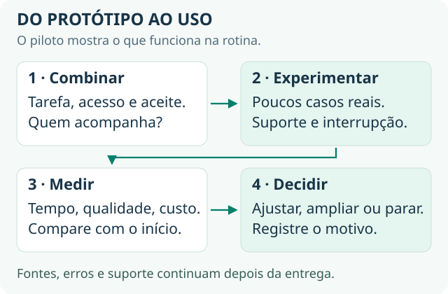

# 7 · Entrevista e mercado

[← Onde buscar](onde-buscar.md) · [Guia principal](../README.md)

**O objetivo:** transformar o que você aprendeu e construiu em uma vaga, um projeto ou um cliente. Saber os conceitos ajuda; o que convence é mostrar critério e evidência.

**Pronto quando:** você responde às nove perguntas abaixo com segurança, tem um projeto para mostrar com números e consegue escrever uma oferta com escopo e critério de aceite.

## As nove perguntas que mais aparecem

| Pergunta | Resposta curta | O que marca |
| --- | --- | --- |
| **1. O que é RAG?** | Buscar os trechos relevantes na base e colocá-los no prompt antes de chamar o modelo. O modelo não aprende nada e a resposta atualiza quando o documento muda. | Dizer que há dois momentos, indexar e consultar, e que a maior parte dos problemas está no primeiro. |
| **2. Quando usar fine-tuning?** | Para comportamento e formato, não para conhecimento. Só depois de esgotar o prompt. | Falar a ordem em voz alta: prompt → RAG → *fine-tuning*, com cada degrau custando mais. |
| **3. Como lidar com alucinação?** | Reduzir dando a fonte no contexto e instruindo a recusar; detectar comparando a resposta com a fonte. | Dizer que a verificação automática deixa passar erros e não substitui amostragem humana. |
| **4. Como saber se o sistema está bom?** | Eval com casos reais, resultado binário, rodado a cada mudança, travando o deploy. Em produção, acompanhar reabertura e escalonamento. | Quase todo mundo responde "a gente testa e vê". Uma resposta estruturada aqui vale mais que qualquer termo técnico. |
| **5. Chatbot × agente?** | O chatbot responde. O agente decide a sequência de passos e usa ferramentas para chegar a um objetivo. | A consequência: critério de parada, limite de passos, ponto humano, orçamento e cerca de 4× mais tokens. |
| **6. As respostas estão ruins. O que você faz?** | Isolo a camada. O trecho certo foi recuperado? Se não, é chunking ou busca. Se foi e a resposta errou, é prompt ou modelo. Se está certa e o problema não se resolveu, é processo. | É uma pergunta de diagnóstico, não de construção. Mostra mais domínio que listar frameworks. |
| **7. Como controlar custo?** | Por token, com entrada e saída separadas, acompanhando o custo **por resolução**. As alavancas são contexto menor, cache de prompt e modelo menor onde dá. | Citar que o cache tem preço bem menor e falha em silêncio abaixo do tamanho mínimo. |
| **8. Segurança e dados sensíveis?** | Todo conteúdo externo é entrada não confiável. A defesa é limitar o que a ferramenta pode executar. Gravar ou não o conteúdo das conversas é decisão de LGPD com o cliente. | Citar o [OWASP Top 10 para LLM](https://genai.owasp.org/llm-top-10/). |
| **9. Conte um problema real em produção.** | Estrutura: contexto → o que quebrou → como descobriu → o que fez → o que mudou no número → o que faria diferente. | Um caso pequeno e honesto vence um grande e genérico. As duas últimas partes são as que quase ninguém traz. |

Para a resposta completa de cada pergunta, veja o bloco 6 da [Base técnica de IA](../materiais/Base%20Técnica%20de%20IA.html). Para os conceitos, volte aos [fundamentos](fundamentos.md).

## Quando você não souber

- **Honestidade com direção:** "Nunca usei Snowflake. Uso Postgres; o conceito de *warehouse* eu entendo e a sintaxe eu pego rápido."
- **Redirecione para o mecanismo:** "Não sei o detalhe dessa biblioteca, mas o problema que ela resolve é X, e a decisão que importa é Y."
- **Pergunte de volta:** "Como vocês resolvem isso hoje?"

**Nunca invente familiaridade.** O entrevistador aprofunda uma pergunta e a conversa inteira perde crédito.

## Se você vem de negócio ou processos

Você está aprendendo o vocabulário técnico, e a maioria de quem tem esse vocabulário não sabe fazer o que você faz:

- **Escolher o caso de uso.** A barreira número um das empresas é "não sei onde aplicar".
- **Desenhar o fluxo.** A maior parte do valor está em fluxo bem desenhado, não em agente autônomo.
- **Definir o sucesso antes:** qual métrica muda, qual é o número de hoje, o que não pode piorar.
- **Traduzir para o cliente**, por exemplo explicando em uma frase por que não se treina o modelo com o dado dele.

> **A frase que amarra:** "Meu ponto forte é ligar o problema de negócio ao desenho técnico: escolher onde a IA entra, qual métrica ela move e como a gente prova que moveu. Da construção, conheço o suficiente para tomar decisões de arquitetura e conversar de igual para igual com quem implementa."

## O que mostrar: seu portfólio

| Evidência | Onde vem do guia |
| --- | --- |
| Repositório com a ficha do projeto, registros de experimento e casos de avaliação | [Prática](pratica.md#três-registros-para-copiar) |
| Demonstração gravada em poucos minutos: problema, solução, resultado e um limite | Entrega 4 da [prática](pratica.md) |
| Números de antes e depois, separando o que foi **medido** do que é **estimado** | Linha de base + eval |
| Posts de build in public mostrando a evolução | [Comunidade](comunidade.md) |

## Do projeto à oferta

Se alguém se interessar, proponha um **piloto pago**, com escopo que caiba no que você já testou:

| Campo | O que escrever |
| --- | --- |
| **Problema e para quem** | O processo específico e quem o executa hoje. |
| **Entrega** | O que o agente faz, em uma frase. |
| **Fica fora** | O que continua com uma pessoa, como preço, decisão final ou envio sem revisão. |
| **Critério de aceite** | Os casos combinados que precisam passar. |
| **Métrica** | O número de hoje e a meta, e o que não pode piorar. |
| **Prazo e valor** | O que foi combinado para esse escopo. |
| **Consumo e manutenção** | Quem paga modelos e ferramentas, quem atualiza as fontes e quem trata as falhas. |
| **Próxima decisão** | Continuar, ajustar ou encerrar após revisar os resultados. |

**Prometa o número que você mediu, não uma transformação.** Entregar 15% depois de prometer 15% é sucesso. Entregar os mesmos 15% depois de prometer transformação queima a confiança.

Para aprender a vender e implementar IA em empresas junto de quem já faz isso, venha para a [comunidade Dizevolv](https://comunidade.dizevolv.com/).
