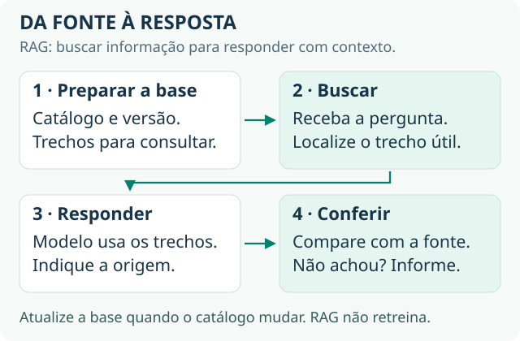
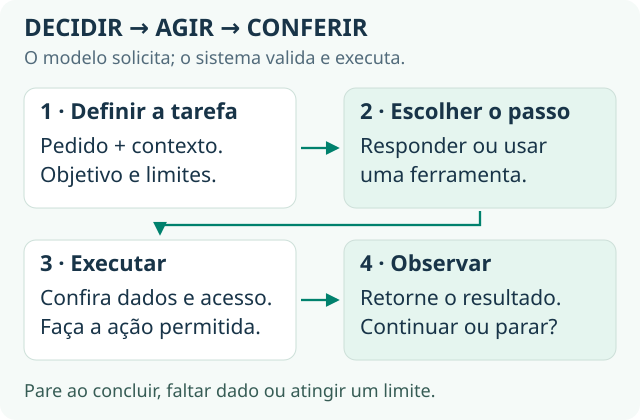

# 2 · Fundamentos: os 27 conceitos

[← História](historia.md) · [Guia principal](../README.md) · Próximo: [Prática →](pratica.md)

São 27 conceitos, na ordem em que precisam ser aprendidos. Para cada um, você precisa saber **o que é** e **como falar dele** numa conversa técnica. Se um conceito parecer solto, é porque você pulou o anterior.

**Pronto quando:** você explica cada conceito em uma frase e sabe em qual parte do seu projeto ele aparece. O material completo, com analogias e exemplos, é a [Base técnica de IA](../materiais/Base%20Técnica%20de%20IA.html), que leva cerca de 40 minutos.

## Bloco 1 · O que um modelo de linguagem realmente faz

Quase todo mal-entendido vem de achar que o modelo "sabe" ou "consulta" algo. Ele não faz nem uma coisa nem outra.

| Conceito | O que é | Como falar |
| --- | --- | --- |
| **1 · LLM** | Um programa que prevê o próximo pedaço de texto, repetido milhares de vezes. É um autocompletar em escala absurda. | "Ele não consulta nada sozinho. Tudo que usa para responder precisa estar no que a gente enviou." |
| **2 · Token** | A unidade de texto do modelo, um pedaço de palavra. Em português, 1 token equivale a cerca de 3–4 caracteres. | "Custo se calcula por token, com entrada e saída cobradas separadamente." |
| **3 · Janela de contexto** | Tudo que cabe numa chamada: instrução, histórico, documentos e resposta. É zerada a cada chamada. | "O modelo não tem memória entre chamadas. A aplicação remonta o contexto a cada vez." |
| **4 · Prompt e system prompt** | O prompt é tudo que vai na chamada. O system prompt é a parte fixa, com papel, regras e limites. | "O system prompt é versionado como código. Mudou o prompt, mudou o produto, e isso exige teste." |
| **5 · Treinamento, inferência e data de corte** | Treinar é construir o modelo; inferência é usá-lo; a data de corte é até quando ele viu dados do mundo. | "A gente não treina com o dado do cliente. A gente dá acesso ao dado no momento da consulta." |
| **6 · Temperatura** | Controla o quanto o modelo arrisca em vez de escolher a continuação mais provável. | "Para tarefa determinística, uso temperatura baixa. Sem isso não dá para medir regressão." |
| **7 · Alucinação** | Uma resposta que soa correta e não é. É o mecanismo funcionando normalmente, sem verificação. | "Alucinação se reduz e se detecta, não se elimina." |

## Bloco 2 · RAG e os dados da empresa

O modelo não conhece o manual nem a tabela de preços do cliente. RAG aparece em praticamente toda vaga.

| Conceito | O que é | Como falar |
| --- | --- | --- |
| **8 · Embedding** | Um texto convertido numa lista de números que representa o seu significado. | "Permite achar o trecho certo mesmo quando o usuário usa palavras que não estão no documento." |
| **9 · Banco vetorial** | Guarda os vetores e responde "traga os cinco trechos mais parecidos com este". | "Na maioria dos casos, pgvector no Postgres que o cliente já tem resolve, com um componente a menos." |
| **10 · Chunking** | Quebrar documentos em pedaços antes de indexar. Respeitar a estrutura (seção, artigo) funciona melhor que cortar por tamanho. | "Quando o RAG vai mal, olho primeiro o chunking, não o modelo." |
| **11 · RAG** | Buscar os trechos relevantes e colocá-los no prompt antes de chamar o modelo. Tem dois momentos: indexar e consultar. | "O modelo não aprende nada, recebe a fonte junto. Mudou o documento, mudou a resposta." |
| **12 · Fine-tuning** | Continuar o treino de um modelo pronto com exemplos seus. Ensina formato e tom, não fatos. | "Fine-tuning resolve estilo, não conhecimento. Esgoto prompt e RAG antes." |
| **13 · As três camadas de falha** | Recuperação (achou o trecho certo?), geração (a resposta se sustenta no trecho?) e resultado (resolveu o problema?). | "Antes de trocar o modelo, isolo a camada." |
| **14 · Três formas de dar conhecimento** | Prompt para conteúdo pequeno e estável; RAG para conteúdo grande ou que muda; *fine-tuning* para formato repetível. | "Primeiro prompt, depois RAG, *fine-tuning* por último. Cada degrau custa mais." |

## Bloco 3 · De chatbot a agente

É o que transforma texto em ação, a parte que mais aparece em vaga e a que mais gera confusão.

| Conceito | O que é | Como falar |
| --- | --- | --- |
| **15 · Tool use / function calling** | Você descreve as funções disponíveis; o modelo pede a chamada com parâmetros; o seu código executa. | "O modelo não executa, ele pede. Permissão e risco ficam no código, nunca no prompt." |
| **16 · Agente** | Um sistema em ciclo: objetivo, próximo passo, ferramenta, resultado, nova decisão. Quem escolhe a sequência é o modelo. | "Agente precisa de critério de parada, limite de passos e ponto de intervenção humana." |
| **17 · Fluxo com IA × agente autônomo** | No fluxo, você desenha os passos. No agente, ele monta o caminho. São escolhas diferentes, não níveis. | "Começo determinístico e só dou autonomia onde a variabilidade justifica." |
| **18 · MCP** | Padrão aberto para conectar modelos a ferramentas e fontes de dados. Funciona como uma tomada padronizada. | "MCP padroniza a conexão. Não resolve permissão, qualidade nem custo." |
| **19 · Orquestração** | LangChain, LangGraph, n8n, LiteLLM e afins organizam o trabalho em volta do modelo. | "Framework é a parte que menos importa e a que mais muda. Escolho pelo que o time mantém." |

**Números para orçamento:** um agente consome cerca de 4× mais tokens que um chat, e um sistema multiagente cerca de 15×. Fonte: [Anthropic, multi-agent research system](https://www.anthropic.com/engineering/multi-agent-research-system).

## Bloco 4 · A infraestrutura que aparece nas vagas

Nada disso é IA. É engenharia de software e de dados, e por isso aparece em toda vaga de IA.

| Conceito | O que é | Como falar |
| --- | --- | --- |
| **20 · API e REST** | O jeito padrão de dois sistemas conversarem. O vocabulário mínimo é endpoint, GET/POST, JSON, chave de API, webhook e *rate limit*. | "A atenção vai para o *rate limit* e para o tratamento de erro quando o outro lado cai." |
| **21 · SQL e data warehouse** | SQL consulta bancos. *Warehouses* como BigQuery e Snowflake servem para análise histórica. | "A maior parte do trabalho é dado. O modelo é a última etapa." Se for aprender uma coisa de código, aprenda SQL. |
| **22 · ETL e pipeline** | Extrair, transformar e carregar dados de forma automática e repetida. | "Base de RAG sem pipeline de atualização morre em três meses." |
| **23 · Serverless** | Rodar código sem manter servidor, como AWS Lambda. Atenção ao *cold start* e ao limite de tempo. | "Serve para carga irregular. Atrapalha em fluxo de agente longo." |
| **24 · Latência, custo e cache** | Olhe o p95, não a média. A leitura de cache de prompt custa uma fração do token normal (na Anthropic, cerca de 10%) e falha em silêncio. | "Acompanho p95 e custo por resolução, não por chamada." |

## Bloco 5 · Qualidade, medição e risco

A parte que quase ninguém domina, e onde quem vem de processo e negócio tem vantagem.

| Conceito | O que é | Como falar |
| --- | --- | --- |
| **25 · Eval** | Casos de teste com resposta esperada. Comece com 20 a 50 casos reais e resultado binário, passou ou não passou. | "Monto o eval antes de mexer no prompt e travo o deploy nele." |
| **26 · Observabilidade** | Registrar cada passo de cada execução: o que foi buscado, enviado, respondido, quanto custou e quanto demorou. Exemplo: Langfuse. | "Rastreamento desde o primeiro dia. Gravar ou não o conteúdo é conversa de LGPD com o cliente." |
| **27 · Guardrails e injeção de prompt** | *Guardrail* é a checagem em volta do modelo. Injeção é uma instrução escondida num conteúdo externo, como e-mail, PDF ou página. | "Todo conteúdo externo é entrada não confiável. A defesa é limitar o que a ferramenta pode fazer." Referência: [OWASP Top 10 para LLM](https://genai.owasp.org/llm-top-10/). |

## O que denuncia iniciante

| Denuncia | Credencia |
| --- | --- |
| "A gente treina a IA com os dados do cliente." | "A gente dá acesso ao dado no momento da consulta, via RAG." |
| "Com um prompt bom ele para de alucinar." | "O prompt reduz a frequência. O que dá segurança é verificar contra a fonte." |
| "Usei o modelo X, o melhor do mercado." | "Escolhi pelo custo por tarefa resolvida no meu eval." |
| "Funcionou muito bem nos testes." | "Passou em 28 dos 30 casos; os dois que falharam são do mesmo tipo." |
| "Montei um agente que faz tudo sozinho." | "Deixei determinístico onde dava e dei autonomia onde pagava." |

## Para onde ir agora

| Para aprofundar | Vá em |
| --- | --- |
| Modelo por dentro | [3Blue1Brown: redes neurais e atenção](https://www.3blue1brown.com/topics/neural-networks) e [Karpathy: Zero to Hero](https://karpathy.ai/zero-to-hero.html) |
| RAG, avaliação e arquitetura | [*AI Engineering*, de Chip Huyen](https://huyenchip.com/books/), com os [recursos do livro](https://github.com/chiphuyen/aie-book) |
| Agentes: quando usar fluxo ou autonomia | [Building effective agents, da Anthropic](https://www.anthropic.com/engineering/building-effective-agents) |
| Exercícios práticos de agentes | [Agents Course, da Hugging Face](https://huggingface.co/learn/agents-course/unit0/introduction) |
| Lições guiadas, do zero | [Generative AI for Beginners, da Microsoft](https://github.com/microsoft/generative-ai-for-beginners) |
| MCP | [Introdução oficial](https://modelcontextprotocol.io/docs/getting-started/intro) |
| HTTP e SQL | [MDN: visão geral do HTTP](https://developer.mozilla.org/pt-BR/docs/Web/HTTP/Guides/Overview) e [tutorial do PostgreSQL](https://www.postgresql.org/docs/current/tutorial.html) |

Depois, coloque os conceitos em uso na [prática](pratica.md).
