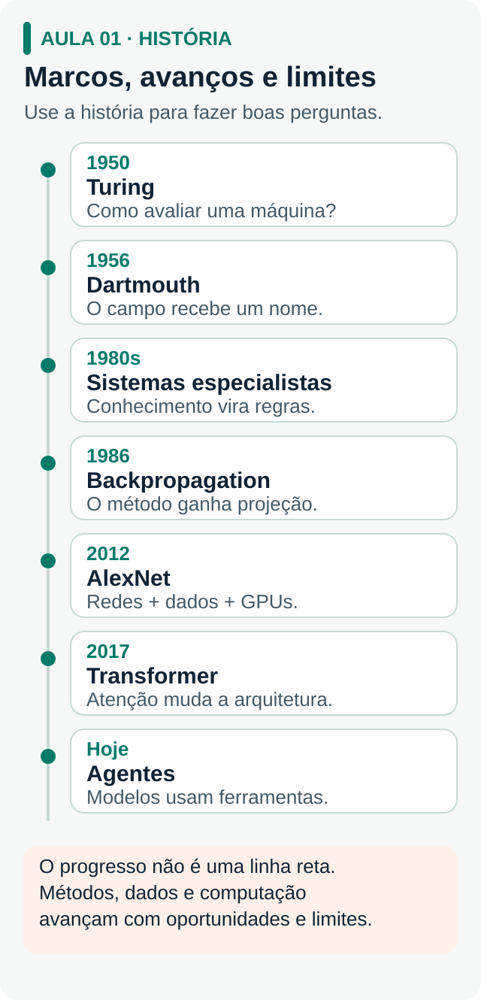

# 1 · História da IA: o que você precisa saber

[← Guia principal](../README.md) · Próximo: [Fundamentos →](fundamentos.md)

**Não é para decorar datas.** É para entender por que as coisas aconteceram nessa ordem, porque os mesmos padrões decidem quais projetos de IA dão certo numa empresa hoje. Esse assunto aparece em entrevistas e em reuniões técnicas.

**Pronto quando:** você consegue contar a linha do tempo em dois minutos, explicar backpropagation, escala e Transformer sem matemática e citar as cinco lições.

## A linha do tempo em sete blocos

| Período | Marcos que você precisa citar | A lição |
| --- | --- | --- |
| **1943–1955 · Fundações** | McCulloch e Pitts publicam o modelo matemático do neurônio (1943). Turing publica *Computing Machinery and Intelligence* e propõe o teste (1950). Samuel cria o programa de damas que aprende e cunha *machine learning* (1959). | O campo destravou quando a pergunta filosófica virou um teste operacional. Defina a métrica antes de aprovar o projeto. |
| **1956–1973 · Euforia** | Workshop de Dartmouth (1956): McCarthy, Minsky, Shannon, Newell e Simon dão nome à IA. Rosenblatt e o Perceptron (1958). Weizenbaum e o ELIZA (1966). Minsky e Papert mostram que o Perceptron de uma camada não resolve o XOR (1969). Relatório Lighthill (1973). | As pessoas atribuem inteligência a quem só combina padrões. Isso impressiona numa demonstração e vira problema em produção. |
| **1974–1980 · 1º inverno** | Verba cortada nos EUA e no Reino Unido. | O inverno veio da distância entre o prometido e o entregue, não de falha técnica. |
| **1980–1987 · Sistemas especialistas** | MYCIN diagnosticava infecções. XCON, na DEC, economizava cerca de US$ 40 milhões por ano: o primeiro ROI de IA numa empresa. Japão lança a Quinta Geração (1982). | Escopo estreito, regra clara e processo caro. A fórmula continua valendo. |
| **1987–1995 · 2º inverno** | Sistemas especialistas quebram pelo custo de manutenção. Rumelhart, Hinton e Williams popularizam a *backpropagation* (1986). | O que mata uma automação é o custo marginal de manter. E uma ideia certa pode esperar décadas pelo resto. |
| **1995–2011 · Trabalho silencioso** | Deep Blue vence Kasparov (1997) por força bruta. Hinton mostra que redes profundas são treináveis (2006). Fei-Fei Li lança o ImageNet (2009). Watson vence no *Jeopardy!* (2011). | O marco de 2009 é um conjunto de dados, não um algoritmo. Em projeto real, o gargalo costuma ser dado organizado com resposta certa. |
| **2012–2022 · A virada** | AlexNet (2012) junta backprop, ImageNet e GPUs. GANs (2014). AlphaGo (2016). *Attention Is All You Need* cria o Transformer (2017). GPT-3 e as *scaling laws* (2020). RLHF ensina o modelo a seguir instruções (2022). ChatGPT em 30/11/2022: 100 milhões de usuários em dois meses. | O maior evento comercial da IA foi de **interface**, não de modelo. Quem construiu acesso venceu. |
| **2023–hoje · Aplicação e agentes** | GPT-4, Claude e Gemini. Pesos abertos com Llama, Mistral e DeepSeek. Modelos de raciocínio (2024). Nobel de Física para Hinton e Hopfield e de Química para Hassabis, Jumper e Baker (2024). Era dos agentes (2025–2026). | O gargalo saiu do "o modelo consegue?" e foi para "o processo está organizado para o modelo operar nele?". |

## Três conceitos para explicar sem matemática

| Conceito | Em uma frase | O que isso explica no dia a dia |
| --- | --- | --- |
| **Backpropagation (1986)** | Percorre a rede de trás para frente, calcula quanto cada parâmetro contribuiu para o erro e ajusta cada um na medida dessa culpa. | O modelo não aprende com a sua conversa, porque os pesos estão travados. Treinar é caro e usar é barato. *Fine-tuning* exige gabarito: sem exemplos com resposta certa, não há erro para medir. |
| **Escala (2012 e 2020)** | O algoritmo de 1986, os dados de 2009 e as GPUs juntos produziram o AlexNet. As *scaling laws* mostraram que mais dados, mais parâmetros e mais computação melhoram o modelo de forma previsível. | IA virou corrida de capital, disputada por poucas empresas. O seu diferencial nunca é "usamos o melhor modelo": é modelo + dado próprio + distribuição. |
| **Transformer e atenção (2017)** | Em vez de ler palavra por palavra, o modelo olha a frase inteira e calcula o quanto cada palavra importa para entender cada outra. | Permitiu paralelizar o treino em milhares de GPUs e manter contexto longo. É o "T" do ChatGPT e a base de todos os LLMs atuais. |

## As cinco lições que se repetem

1. **Invernos são causados por promessa, não por falha técnica.** Vale para o orçamento de um país e para a credibilidade do seu projeto.
2. **A tecnologia chega antes do caso de uso viável.** Antes de descartar uma ideia, pergunte que peça falta: dado, processamento, algoritmo ou processo.
3. **O gargalo muda de lugar.** Já foi processamento, dado e algoritmo. Hoje é processo e integração.
4. **Escopo estreito ganha de ambição larga.** O XCON gerou milhões configurando computadores; a Quinta Geração queimou centenas de milhões tentando reinventar a computação.
5. **A camada que captura valor sobe com o tempo.** Primeiro hardware, depois modelo, depois aplicação; agora, fluxo de trabalho.

## Não repita isto numa conversa técnica

| Circula por aí | O correto |
| --- | --- |
| "A Microsoft investiu US$ 10 bi na OpenAI antes do ChatGPT." | O investimento veio depois, em janeiro de 2023, como reação ao sucesso. |
| "Turing previu que 70% não saberiam se falam com máquina." | Ele disse que o interrogador teria no máximo 70% de chance de acertar após cinco minutos. |
| "Hinton criou a backpropagation." | Ele a popularizou em 1986, com Rumelhart e Williams. A técnica já aparecia nos anos 70. |
| "O Nobel de Química de 2024 foi para o Google." | Foi dividido entre Hassabis e Jumper, da DeepMind, e Baker, da Universidade de Washington. |
| "Modelos passam no teste de Turing regularmente." | Existe um estudo controlado relevante, de 2025, não um corpo consolidado de evidências. |
| "LLM é inversão de matrizes." | É multiplicação de matrizes e ajuste por gradiente. Não há inversão de matriz. |
| "É só um papagaio estatístico." | Essa é uma tese contestada, de 2021. Cite como posição no debate, não como fato. |
| "Os algoritmos já existiam, só faltava máquina." | Meia-verdade. Também faltavam backprop (1986), Transformer (2017) e RLHF (2022). |

**Nomes que transcrições automáticas costumam errar:** Frank Rosenblatt, David Rumelhart, Yann LeCun, Yoshua Bengio, Alex Krizhevsky, Ilya Sutskever, MYCIN, XCON, XOR, ImageNet, AlexNet.

## Para onde ir agora

Leia o material completo, [Como a inteligência artificial chegou até aqui](../materiais/historia-da-ia-material-de-formacao.html), em cerca de 25 minutos. Depois, suba a escada de leituras abaixo. Ela vai do mais acessível ao mais técnico, e o caminho é escolher **um** item por nível, não ler a lista toda.

| Nível | Comece por | Para quê |
| --- | --- | --- |
| **1 · Entender o campo** | [*Artificial Intelligence: A Guide for Thinking Humans*, de Melanie Mitchell](https://us.macmillan.com/books/9781250404855/artificialintelligence/), ou [*Genius Makers*, de Cade Metz](https://www.penguinrandomhouse.com/books/565698/genius-makers-by-cade-metz/) | Como funciona por dentro, sem equações, e a história contada pelas pessoas. |
| **2 · Lógica de negócio** | [*Máquinas Preditivas*, de Agrawal, Gans e Goldfarb](https://www.predictionmachines.ai/), ou [*Co-Intelligence*, de Ethan Mollick](https://www.penguinrandomhouse.com/books/741805/co-intelligence-by-ethan-mollick/) | Decidir onde aplicar IA e como trabalhar junto com ela. |
| **3 · Técnico e legível** | [*AI Engineering*, de Chip Huyen](https://huyenchip.com/books/) | O livro do cargo: RAG, avaliação, custo e quando fazer *fine-tuning*. |
| **4 · Textos originais** | [*The Bitter Lesson*, de Rich Sutton](http://www.incompleteideas.net/IncIdeas/BitterLesson.html) (três páginas) | O texto mais importante da lista. Depois vêm [Turing, 1950](https://turingarchive.kings.cam.ac.uk/publications-lectures-and-talks-amtb/amt-b-9), [Attention Is All You Need](https://arxiv.org/abs/1706.03762), [Scaling Laws](https://arxiv.org/abs/2001.08361) e [InstructGPT/RLHF](https://arxiv.org/abs/2203.02155). Leia a introdução e as conclusões. |
| **Vídeo** | [3Blue1Brown: redes neurais](https://www.3blue1brown.com/topics/neural-networks) | A melhor explicação visual de backpropagation. Em paralelo, se quiser abrir o capô: [Karpathy: Zero to Hero](https://karpathy.ai/zero-to-hero.html). |

**Não comece por** *Deep Learning*, de Goodfellow, Bengio e Courville, nem por *Artificial Intelligence: A Modern Approach*, de Russell e Norvig. São obras de referência, não leitura corrida.
