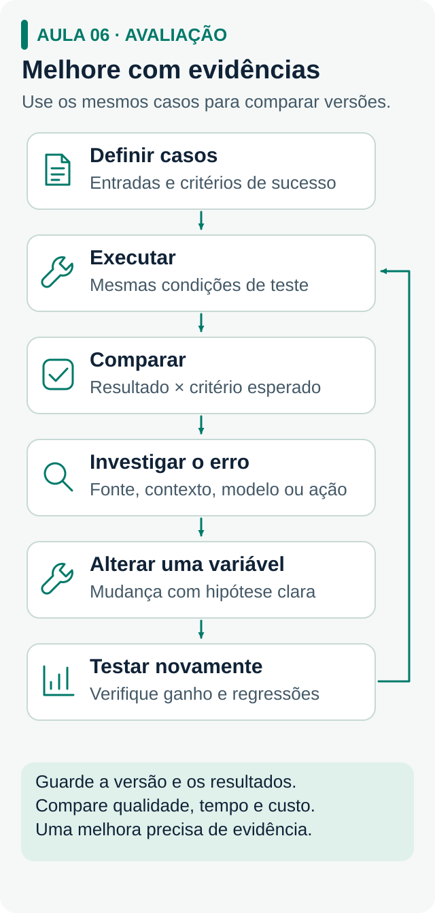

# 3 · Prática: um problema real, quatro entregas

[← Fundamentos](fundamentos.md) · [Guia principal](../README.md) · Próximo: [Comunidade →](comunidade.md)

**A regra:** escolha um problema real, construa um agente para ele e melhore o mesmo projeto em quatro entregas. Você aprende o que o projeto pede, na hora em que ele pede.

**Pronto quando:** você mostra a alguém que faz o trabalho uma solução testada, com números de antes e depois e uma limitação conhecida.

## Escolha o problema certo

Procure **um processo específico, repetitivo e caro**, não uma categoria. "Melhorar o atendimento" não serve; "organizar pedidos de orçamento que chegam por mensagem" serve. Converse com quem faz o trabalho:

- **"Mostre como você tratou o último caso."** Isso revela o processo real e as exceções.
- **"Onde você precisa voltar e perguntar de novo?"** Isso mostra a informação que falta.
- **"O que acontece quando um caso se perde?"** Isso mostra o custo para o negócio.
- **"Como saberíamos que ajudou?"** Isso define a métrica.

Anote a **linha de base**: tempo por caso, retrabalho, erros. Sem esse número, não há demonstração.

**Sem um problema à mão?** Use o exemplo: um prestador de instalação e manutenção recebe pedidos de orçamento por mensagem. O agente organiza o pedido e aponta o que falta, enquanto preço e agenda continuam com o prestador.

## Antes de construir: cinco perguntas

São tiradas da [história](historia.md). Rode-as antes de estimar qualquer projeto.

1. **O escopo é estreito o suficiente?** Que processo específico e caro isso ataca? (lição do XCON)
2. **Qual o custo de manter isso daqui a doze meses?** Cada caso novo vai exigir alguém escrevendo regra à mão? (lição do segundo inverno)
3. **Existe gabarito?** Há exemplos com resposta certa para testar? (lição do ImageNet)
4. **Onde está o diferencial?** Se a resposta for "usamos o melhor modelo", não há diferencial. (lição de 2012)
5. **O que exatamente estamos prometendo?** Escreva o número antes de começar. (lição dos invernos)

## As quatro entregas

| Entrega | Pronta quando | Conceitos que você vai usar |
| --- | --- | --- |
| **1 · Uma tarefa funcionando** | O agente transforma a entrada numa saída conferível (campos, classificação, rascunho) em três casos: normal, incompleto e fora do escopo. Outra pessoa consegue dizer se está certo. | LLM, prompt, system prompt, temperatura e alucinação ([bloco 1](fundamentos.md#bloco-1)) |
| **2 · Respostas com fonte** | Responde com base num documento versionado e mostra o trecho usado. Diz "não sei" quando não há base. Mudou a fonte, mudou a resposta. | Prompt × RAG, chunking e as três camadas de falha ([bloco 2](fundamentos.md#bloco-2)) |
| **3 · Uma ação útil** | Executa uma ação real, como registrar numa planilha ou num CRM, com a permissão definida no código. Não duplica registros, para quando falta dado e não diz "salvei" sem ter salvo. | Tool use, fluxo × agente, MCP, API e SQL ([blocos 3 e 4](fundamentos.md#bloco-3)) |
| **4 · Testada e demonstrada** | Tem um eval com casos reais e resultado binário, comparação entre versões, números contra a linha de base e uma demonstração para quem usa, com uma limitação conhecida. | Eval, observabilidade, guardrails e custo ([blocos 4 e 5](fundamentos.md#bloco-5)) |

**Com que ferramenta?** Com a que você já consegue usar: o agente do [curso da Dizevolv](https://comunidade.dizevolv.com/), o [Hermes](https://youtu.be/VHh2D9agRps), n8n ou código próprio. Na [página do ecossistema](ecossistema.md) você encontra o resto. A ferramenta importa menos que a entrega funcionando.

<p class="compact-visual"><a href="../mapas-e-desenhos/06-avaliacao.svg"></a></p>

## Quando algo falhar

Antes de trocar o modelo, isole a camada:

| Você observa | Confira primeiro |
| --- | --- |
| Informação errada ou desatualizada | O trecho certo foi recuperado? A base está atualizada? |
| Fonte certa, resposta errada | A instrução orienta o uso da fonte e a recusa? |
| Texto certo, tarefa não concluída | A ferramenta executou? O efeito aparece no destino? |
| Funcionava e parou | Qual versão de prompt, fonte, modelo ou ferramenta mudou? |

Mude **uma coisa por vez**, rode os mesmos casos e acrescente cada falha nova ao eval.

## Ritmo: uma sessão de uma hora

1. **10 min · Entender.** Leia só o conceito que destrava o problema de hoje.
2. **30 min · Construir.** Faça a menor mudança que testa a ideia.
3. **15 min · Verificar.** Rode os casos de sempre, mais o caso novo.
4. **5 min · Registrar.** Anote o que mudou, o resultado e o próximo teste. Se der, publique (veja [comunidade](comunidade.md)).

## Três registros para copiar

Guarde-os no repositório do projeto. Eles são a sua evidência em entrevista e na hora de vender.

**Ficha do projeto**

```text
Quem usa:
Processo que o agente ajuda:
Linha de base (número de hoje):
Fontes que ele pode consultar:
Ações que ele pode executar:
Quando deve parar ou chamar uma pessoa:
Métrica de sucesso (e o que não pode piorar):
```

**Registro de experimento**

```text
Data / versão:
Problema observado:
Mudança feita (uma só):
Resultado esperado:
Resultado nos casos de teste (antes → depois):
Decisão: manter, ajustar ou desfazer
```

**Casos de avaliação**

```text
Caso | Entrada | Esperado | Observado | Passou? | Camada da falha
```

Comece com cinco situações: caso comum, informação ausente, pedido ambíguo, ação repetida e ferramenta indisponível. Cresça para 20 a 50 casos tirados de falhas reais.

## Para onde ir agora

- **Decidir entre fluxo e agente:** [Building effective agents, da Anthropic](https://www.anthropic.com/engineering/building-effective-agents)
- **Montar o eval:** [Boas práticas de avaliação, da OpenAI](https://developers.openai.com/api/docs/guides/evaluation-best-practices) e [Demystifying evals for AI agents, da Anthropic](https://www.anthropic.com/engineering/demystifying-evals-for-ai-agents)
- **Experimentar em pequenos ciclos:** [princípios da Lean Startup](https://theleanstartup.com/principles)
- **Versionar o projeto:** [Introduction to GitHub, no GitHub Skills](https://github.com/skills/introduction-to-github)
- **Travou?** Leve a dúvida à [comunidade](comunidade.md) com o roteiro de pergunta.
